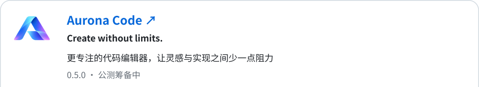
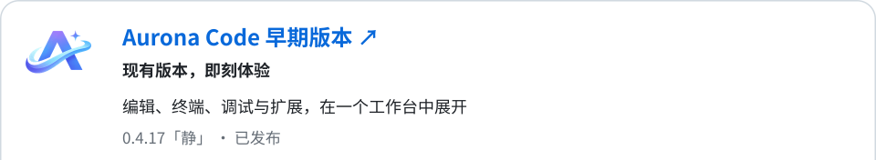

<picture>
  <source media="(prefers-color-scheme: dark)" srcset="./assets/aurona-hero-dark.svg" />
  <source media="(prefers-color-scheme: light)" srcset="./assets/aurona-hero-light.svg" />
  
</picture>

 

<h3>实用的产品，顺手的服务</h3>

从账号连接，到模型接入，再到自由创作

  <a href="https://account.aurona.cc">账号中心 ↗</a>
  &nbsp; · &nbsp;
  <a href="https://ai.aurona.cc">模型服务 ↗</a>
  &nbsp; · &nbsp;
  <a href="https://github.com/AuronaLabs/AuronaCode">Aurona Code ↗</a>
  &nbsp; · &nbsp;
  <a href="https://github.com/AuronaLabs/AuronaCode-Early">Aurona Code 早期版本 ↗</a>

 

## 在线服务

  <a href="https://account.aurona.cc">
    <picture>
      <source media="(prefers-color-scheme: dark) and (max-width: 600px)" srcset="./assets/account-dark-mobile.svg" />
      <source media="(prefers-color-scheme: light) and (max-width: 600px)" srcset="./assets/account-light-mobile.svg" />
      <source media="(prefers-color-scheme: dark)" srcset="./assets/account-dark.svg" />
      
    </picture>
  </a>
  <a href="https://ai.aurona.cc">
    <picture>
      <source media="(prefers-color-scheme: dark) and (max-width: 600px)" srcset="./assets/models-dark-mobile.svg" />
      <source media="(prefers-color-scheme: light) and (max-width: 600px)" srcset="./assets/models-light-mobile.svg" />
      <source media="(prefers-color-scheme: dark)" srcset="./assets/models-dark.svg" />
      
    </picture>
  </a>

 

## 开源项目

<a href="https://github.com/AuronaLabs/AuronaCode"><picture><source media="(prefers-color-scheme: dark) and (max-width: 600px)" srcset="./assets/code-dark-mobile.svg" /><source media="(prefers-color-scheme: light) and (max-width: 600px)" srcset="./assets/code-light-mobile.svg" /><source media="(prefers-color-scheme: dark)" srcset="./assets/code-dark.svg" /></picture></a> 
<a href="https://github.com/AuronaLabs/AuronaCode"><picture><source media="(prefers-color-scheme: dark) and (max-width: 600px)" srcset="./assets/code-primary-dark-mobile.svg" /><source media="(prefers-color-scheme: light) and (max-width: 600px)" srcset="./assets/code-primary-light-mobile.svg" /><source media="(prefers-color-scheme: dark)" srcset="./assets/code-primary-dark.svg" /></picture></a><a href="https://github.com/AuronaLabs/AuronaCode/blob/main/LICENSE"><picture><source media="(prefers-color-scheme: dark) and (max-width: 600px)" srcset="./assets/code-license-dark-mobile.svg" /><source media="(prefers-color-scheme: light) and (max-width: 600px)" srcset="./assets/code-license-light-mobile.svg" /><source media="(prefers-color-scheme: dark)" srcset="./assets/code-license-dark.svg" /></picture></a>

<a href="https://github.com/AuronaLabs/AuronaCode-Early"><picture><source media="(prefers-color-scheme: dark) and (max-width: 600px)" srcset="./assets/code-early-dark-mobile.svg" /><source media="(prefers-color-scheme: light) and (max-width: 600px)" srcset="./assets/code-early-light-mobile.svg" /><source media="(prefers-color-scheme: dark)" srcset="./assets/code-early-dark.svg" /></picture></a> 
<a href="https://github.com/AuronaLabs/AuronaCode-Early/releases/tag/v0.4.17"><picture><source media="(prefers-color-scheme: dark) and (max-width: 600px)" srcset="./assets/code-early-primary-dark-mobile.svg" /><source media="(prefers-color-scheme: light) and (max-width: 600px)" srcset="./assets/code-early-primary-light-mobile.svg" /><source media="(prefers-color-scheme: dark)" srcset="./assets/code-early-primary-dark.svg" /></picture></a><a href="https://github.com/AuronaLabs/AuronaCode-Early/blob/main/LICENSE"><picture><source media="(prefers-color-scheme: dark) and (max-width: 600px)" srcset="./assets/code-early-license-dark-mobile.svg" /><source media="(prefers-color-scheme: light) and (max-width: 600px)" srcset="./assets/code-early-license-light-mobile.svg" /><source media="(prefers-color-scheme: dark)" srcset="./assets/code-early-license-dark.svg" /></picture></a>

 

## 参与开源

让 Aurona Code 早期版本更好用，期待你的参与

  <a href="https://github.com/AuronaLabs/AuronaCode-Early/issues">问题反馈 ↗</a>
  &nbsp; · &nbsp;
  <a href="https://github.com/AuronaLabs/AuronaCode-Early/blob/main/Docs/README.md">产品文档 ↗</a>
  &nbsp; · &nbsp;
  <a href="https://github.com/AuronaLabs/AuronaCode-Early/blob/main/.github/CONTRIBUTING.md">参与贡献 ↗</a>

 

---

Aurona Labs · 软件、服务与开源
